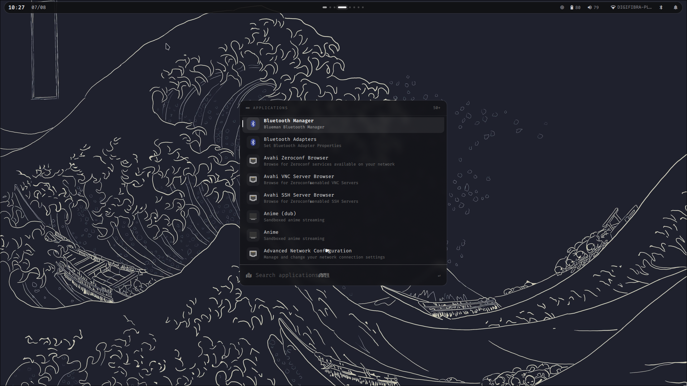
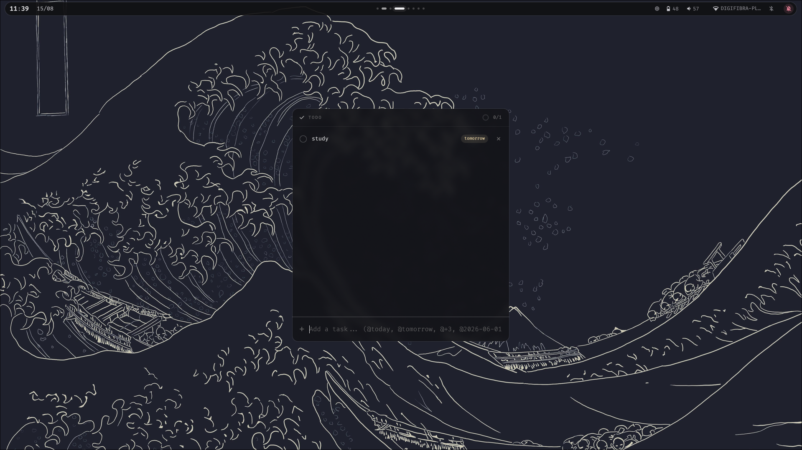

# Arch Linux Installation & Dotfiles

Personal Arch Linux setup with automated installation scripts and dotfiles configuration. Designed for easy deployment on new machines with a focus on Wayland/Hyprland environment.

## Features

- **Automated Base Installation**: Complete Arch Linux installer with LUKS encryption and swap support
- **Post-Installation Automation**: One-command package installation and configuration
- **Wayland Environment**: Hyprland compositor with custom theming via pywal
- **Development Ready**: Pre-configured development tools and environments
- **Location Services**: Configured geoclue with BeaconDB (no rate limits)
- **Custom Utilities**: Sandboxed application launchers and helper scripts

## Screenshots

<table>
  <tr>
    <td></td>
    <td></td>
  </tr>
  <tr>
    <td></td>
    <td></td>
  </tr>
</table>

## Repository Structure

```
.
├── arch-install.sh          # Base system installer (run from live ISO)
├── setup.sh                 # Post-installation setup (run after reboot)
│
├── packages/                # Package lists
│   ├── pacman.txt
│   ├── nvidia.txt          # ( optional )
│   ├── flatpak.txt         # ( manual installation :) )
│   └── yay.txt           
│
├── dotfiles/               # Configuration files
│   ├── config/             # ~/.config directory contents
│   └── zshrc               # Zsh shell configuration
│
├── scripts/                # Helper scripts
│
├── bin/                    # Custom executables
│
├── apps/                   # Desktop application entries
│
├── services.txt            # System services to enable
└── groups.txt              # User groups to add
```

## Installation

### Step 1: Base System Installation

**Option A: arch-setup ISO (recommended, no clone needed)**

Every [GitHub release](https://github.com/ThiagoAVicente/arch-setup/releases)
ships an `arch-setup-<version>-x86_64.iso`: the official Arch live ISO with this
repo preloaded at `/root/arch-setup` and an `arch-setup` command that runs the
installer.

1. **Download** the `.iso` and its `.sha256` from the latest release, then check it:

   ```bash
   sha256sum -c arch-setup-<version>-x86_64.iso.sha256
   ```

2. **Flash it to a USB stick** (everything on the stick is erased). Find the
   stick with `lsblk` and replace `/dev/sdX` with the whole device, not a partition:

   ```bash
   sudo dd if=arch-setup-<version>-x86_64.iso of=/dev/sdX bs=4M status=progress oflag=sync
   ```

   On Windows or macOS use [Rufus](https://rufus.ie) (DD mode) or
   [balenaEtcher](https://etcher.balena.io). Copying it onto a
   [Ventoy](https://www.ventoy.net) stick also works.

3. **Boot from the USB.** Open the firmware boot menu (usually F12, F10, F8 or
   Esc at power-on) and pick the stick. The machine must boot in **UEFI** mode;
   disable Secure Boot if the stick doesn't show up or refuses to boot.

4. **Connect to the internet.** Ethernet works on its own. For Wi-Fi:

   ```bash
   iwctl
   [iwd]# device list                       # wireless device name, e.g. wlan0
   [iwd]# station wlan0 scan
   [iwd]# station wlan0 get-networks
   [iwd]# station wlan0 connect "SSID"      # asks for the password
   [iwd]# exit
   ping -c 3 archlinux.org                   # check it works
   ```

5. **Run the installer:**

   ```bash
   arch-setup
   ```

   It asks for the target disk (**the whole disk is wiped**), hostname, user,
   keymap, passwords, encryption and swap, then installs the base system (see
   what it does below). The repo snapshot is copied to `~/installation` on the
   new system.

6. **Reboot**, remove the USB stick, log in and continue with
   [Step 2](#step-2-post-installation-setup).

To build the ISO yourself: `sudo pacman -S archiso && sudo ./iso/build.sh`
(output in `out/`). Publishing a GitHub release builds it automatically and
attaches it to the release.

**Option B: stock Arch ISO**

Boot from Arch Linux ISO and run:

```bash
# Connect to internet (if needed)
iwctl station wlan0 connect "SSID"

# Install git if not already installed
sudo pacman -S git

# Download this repository
git clone https://github.com/ThiagoAVicente/arch-setup.git
cd arch-setup

# Run the installer
chmod +x arch-install.sh
sudo ./arch-install.sh
```

The installer will:
- Partition your disk (UEFI/GPT)
- Optionally set up LUKS encryption
- Optionally create swap partition
- Install base system with systemd-boot
- Configure locale, timezone, and users
- Copy installation files to `/home/username/installation`

**Reboot after completion.**

### Step 2: Post-Installation Setup

After rebooting into your new system:

```bash
cd ~/installation
chmod +x setup.sh
./setup.sh
```

### Step 3: Update configs

```bash
cd ~/installation
git pull
```

The setup script automatically handles:
- Pacman configuration (multilib, parallel downloads, color)
- All package installation (official + AUR)
- Yay AUR helper installation
- Dotfiles setup via symlinks
- System services enablement
- Geoclue location services configuration
- User group membership
- Initial wallpaper download and pywal setup
- Directory structure creation

**That's it! Everything is configured automatically.**

## Included Software

### Core System
- **Display Protocol**: Wayland
- **Compositor**: Hyprland
- **Display Manager**: ly (TTY-based)
- **Shell**: Zsh with Starship prompt
- **Terminal**: foot
- **Editor**: Zed, Neovim ([Lazyvim config](https://www.lazyvim.org/))

### Desktop Environment
- **Launcher**: Quickshell
- **Status Bar**: Quickshell
- **Notifications**: Quickshell
- **File Manager**: PCMan
- **Audio Visualizer**: CAVA
- **Color Scheme**: Pywal 
- **Screenshot**: Grimblast

### Applications
- **Browser**: Firefox 
- **Media Player**: MPV
- **Image Viewer**: imv and chafa(terminal based)
- **PDF Viewer**: Zathura
- **Office**: LibreOffice
- **Music**: Spotify 

### Development Tools
- **Containers**: Docker(-compose)
- **Virtualization**: libvirt/QEMU
- **Version Control**: Git
- **Code Editors**: Neovim, helix, zed
- **Languages**: Python, Node.js, Go, Rust toolchains

### System Services

Automatically enabled services:
- `NetworkManager` - Network management
- `docker` - Container runtime
- `tlp` - Power management
- `ufw` - Firewall
- `bluetooth` - Bluetooth support
- `systemd-timesyncd` - Time synchronization
- `libvirtd` - Virtualization
- `ly@tty1` - Display manager
- `avahi-daemon` - Network service discovery (required for location services)

See `services.txt` for the complete list.


### Dotfile Modifications

All dotfiles are symlinked from `~/installation/dotfiles/`, so you can:
1. Edit files in the repository
2. Changes take effect immediately (no re-linking needed)
3. Commit and push changes to keep them synced

### Keybindings (Hyprland)

See [KEYBINDINGS](docs/keybindings.md) for full list. Key bindings:

## Requirements

- **UEFI system** 
- **Internet connection** during installation
- **2GB+ RAM** recommended
- **20GB+ disk** recommended
 
## Additional Resources

- [Envycontrol](https://github.com/bayasdev/envycontrol) - GPU mode switcher for NVIDIA Optimus laptops
- [NVIDIA on Hyprland](https://wiki.hypr.land/Nvidia/) - Configuration guide for NVIDIA GPUs
- [Looking Glass](https://looking-glass.io/) - Low-latency KVM framebuffer sharing for GPU passthrough
- [Windows 11 Download](https://www.microsoft.com/en-us/software-download/windows11) - For VM setup

## Documentation

| Topic | Description |
|-------|-------------|
| [Post-Installation](docs/post-install.md) | Final steps after setup |
| [GPU Drivers](docs/gpu.md) | Install Intel/NVIDIA GPU drivers |
| [Hyprland Configuration](docs/hyprland.md) | Machine-specific config with `extra.conf` |
| [Keybindings](docs/keybindings.md) | Full keyboard shortcuts reference |
| [Steam Launch Options](docs/steam.md) | NVIDIA GPU launch options for Steam games |
| [LSPs (**needed for helix**) ](docs/lsp-helix.md) | NVIDIA GPU launch options for Steam games |
## License

MIT License - See [LICENSE](LICENSE) file for details.

## Credits

- Hyprland configuration inspired by the Hyprland community
- Dotfiles structure influenced by various Arch Linux ricing communities

---
